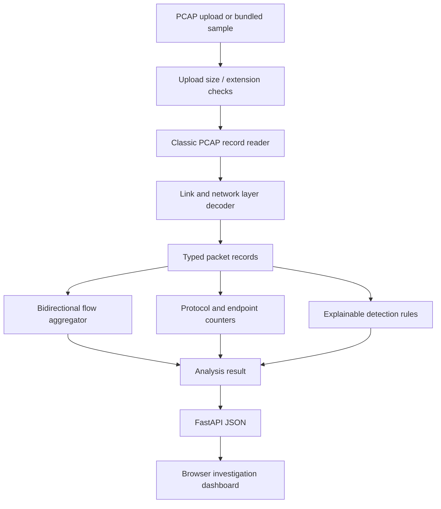

# NetScope architecture

## Components

### 1. Input boundary

`POST /api/analyze` accepts one multipart file. The API checks the extension, reads at most `NETSCOPE_MAX_UPLOAD_BYTES + 1` bytes and rejects files above the configured maximum. The parser then enforces a packet-count ceiling, per-frame ceiling, recognised PCAP magic, PCAP version and supported link-layer type. Uploads are analysed transiently and are not persisted to application-owned storage.

### 2. Capture parser

`parser.py` handles classic PCAP's global header and packet record headers. It supports microsecond / nanosecond timestamp variants and three link types. The decoder is deliberately conservative: malformed or incomplete protocol headers are skipped, unsupported link types fail with a descriptive error, and IP fragments without the first fragment's transport header are ignored.

The parser returns a typed `PacketRecord` with timestamps, endpoint addresses, ports, protocol, frame length, TCP flags, DNS question name and ARP metadata. Raw payload bytes are not retained in the analysis model.

### 3. Flow aggregation

`analyzer.py` groups packets using a canonical bidirectional key:

`(transport, sorted((source IP, source port), (destination IP, destination port)))`

The first packet's direction is retained as the flow's displayed source and destination. Reverse packets increment a separate reverse counter. Each flow has a stable hash ID, packet and byte totals, TCP flag counts and a duration.

### 4. Detection engine

The first version includes seven transparent heuristics. Each rule produces a structured finding with severity, source, destination, summary, evidence and a MITRE ATT&CK technique reference. Thresholds are explicit constants in the rule logic and are documented in the README. Findings are sorted by severity for investigation.

The rules intentionally avoid claiming certainty. A periodic pattern may be a legitimate health check; a long DNS name may be a tracking token; a large transfer may be a backup; and an ARP ownership conflict may be proxy ARP or failover.

### 5. API and dashboard

FastAPI exposes upload, demo, state, rule catalogue, health and JSON export endpoints. The dashboard is a static vanilla-JavaScript client. It renders KPI cards, protocol distribution, top source talkers, alerts and a searchable flow table. Values derived from packet content are escaped before insertion into HTML.

### 6. State model

For a portfolio deployment, only the latest result is held in `app.state`. This keeps the prototype simple and avoids retaining original captures. It is not shared across multiple workers and disappears on restart / spin-down. A production version would use authenticated job submission, a queue, object storage with retention controls, a database for metadata and a worker pool.

## Data flow

## Scaling path

A larger deployment should move parsing out of the request thread into a job queue, store capture objects in encrypted object storage with short retention, persist only derived metadata by default, and apply tenant-aware access controls. Packet and byte budgets should be enforced per tenant. Detection rules should be versioned, configurable and tested against labelled captures before changing defaults.
